<p align="center"></p>

# kaii 食记

我自己健身时会记一下每天吃了什么，有时拍照，有时吃完才想起来。kaii 食记就是为这件事做的，拍张照片或写几句话，让 AI 估一下营养，再按实际吃的份量修改、保存。常吃的东西也可以存下来，第二天点一下就加上了。

目前我自己在用，记餐、查看营养和导出这些基本功能已经可以日常使用。整个 App 是兴趣做的，还有不少细节值得继续打磨。把它开源出来，给有健身或健康饮食需求的人试试，也把这套 App 框架和功能组合留给想继续改进的人。

## 下载

[Android 安装包](https://github.com/ykkai-w/KaiiFood/releases/download/v1.0/kaii-food-v1.0-android.apk) · [iOS IPA](https://github.com/ykkai-w/KaiiFood/releases/download/v1.0/kaii-food-v1.0-ios-unsigned.ipa) · [安装方法](docs/INSTALL.md)

Android 9 及以上可安装 APK。iOS 17 及以上使用 IPA，需要通过个人签名工具或 Xcode 安装。支持 APK 的鸿蒙设备也可使用安卓版，HarmonyOS NEXT 设备需要原生鸿蒙版本。

## 看看界面

以下为 iPhone 15 Pro 实机截图。餐食与营养使用展示数据，餐食图片为插图。点击图片可以查看大图。

### 食记与每日营养

| 首页 | 蛋白质与餐食 | 按餐次记录 |
| --- | --- | --- |
| [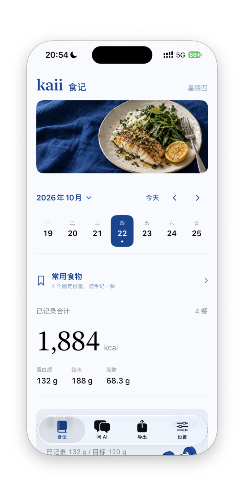](docs/screenshots/02-diary-overview.png) | [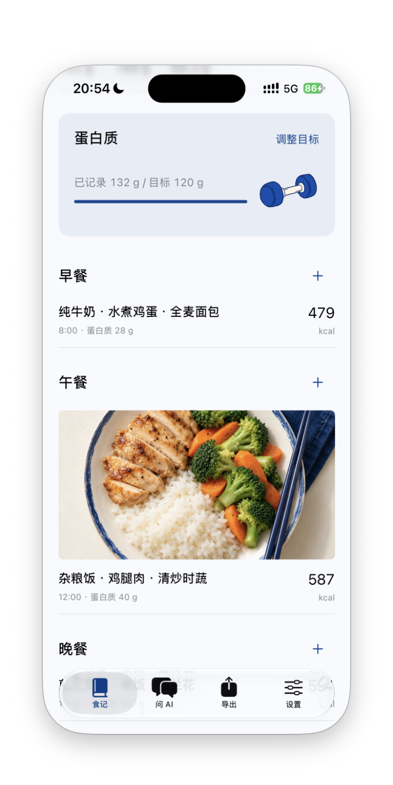](docs/screenshots/03-diary-protein.png) | [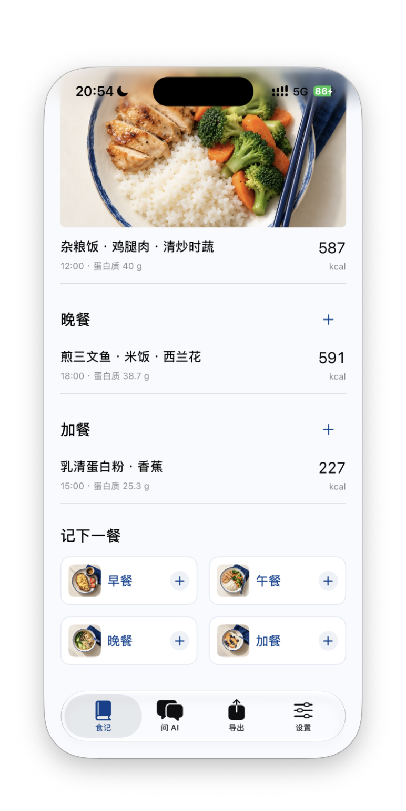](docs/screenshots/04-diary-meals.png) |

### 三种记餐方式

| 描述补记 | 拍照记录 | 包装标签 |
| --- | --- | --- |
| [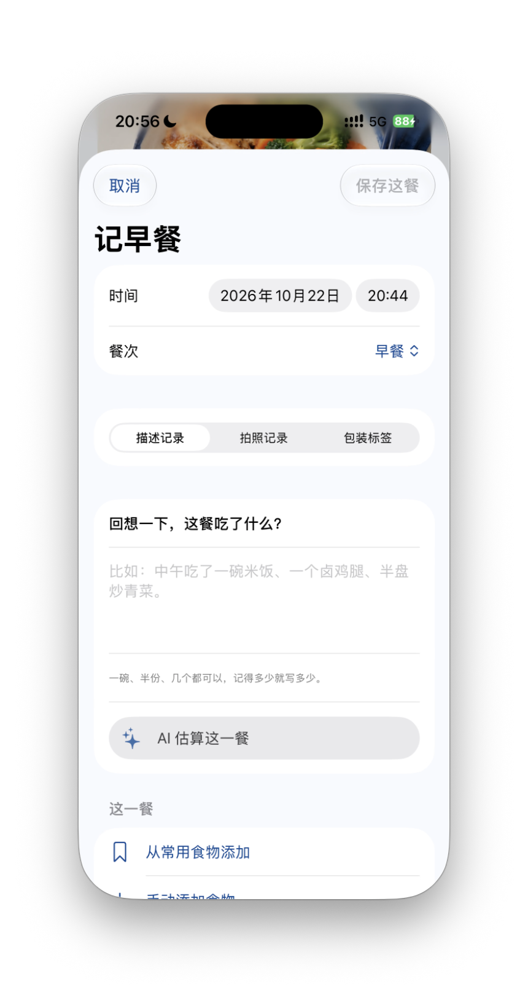](docs/screenshots/05-record-description.png) | [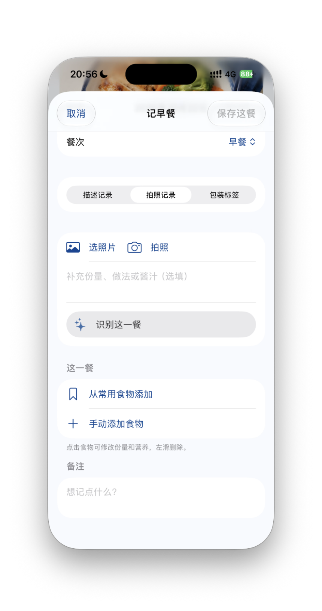](docs/screenshots/06-record-photo.png) | [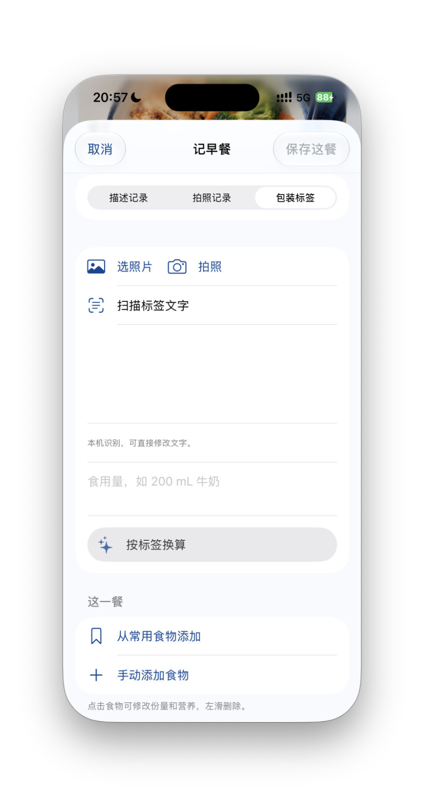](docs/screenshots/07-record-label.png) |

### 和自己的 AI 聊聊

| 问 AI | 示例食记的 AI 问答 |
| --- | --- |
| [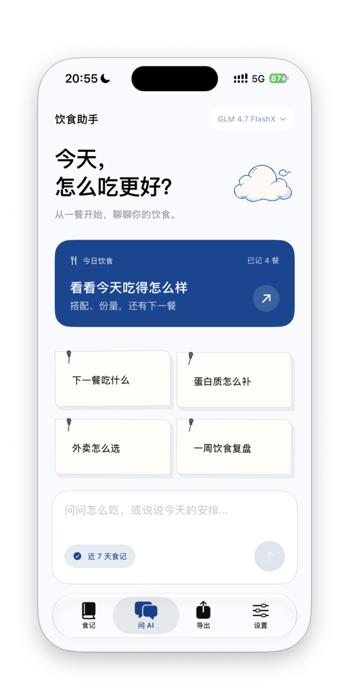](docs/screenshots/08-ai-home.png) | [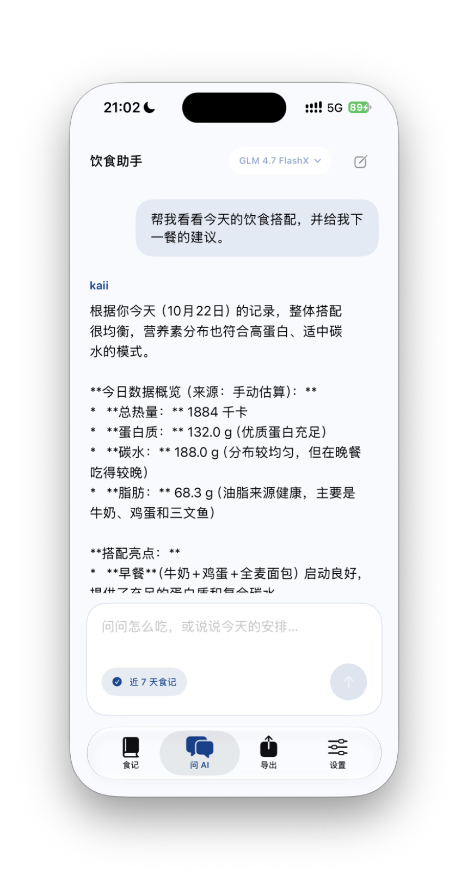](docs/screenshots/09-ai-reply.png) |

### 一键导出

| 选择日期 | 复制、分享与保存 |
| --- | --- |
| [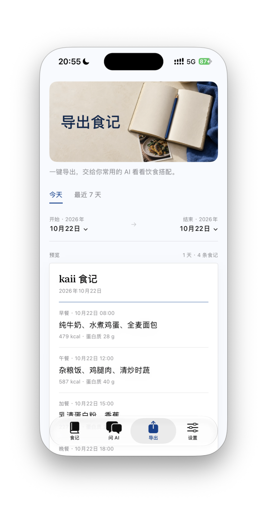](docs/screenshots/10-export-period.png) | [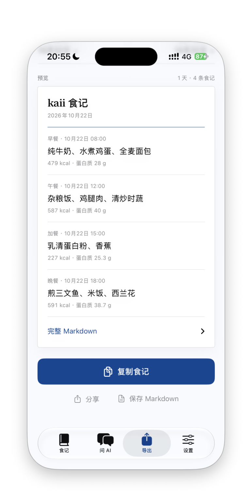](docs/screenshots/11-export-share.png) |

### 开始使用与设置

| 使用说明 | 目标与模型 |
| --- | --- |
| [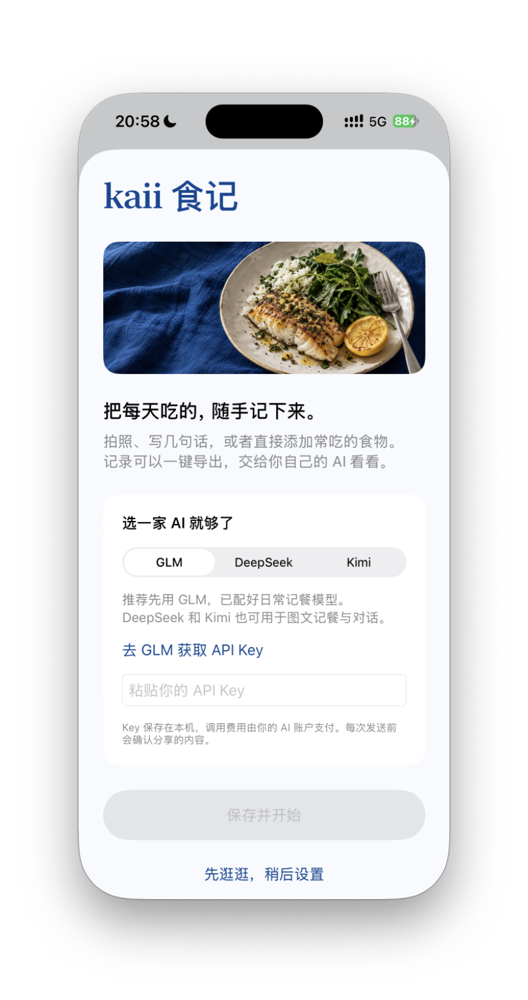](docs/screenshots/01-welcome.png) | [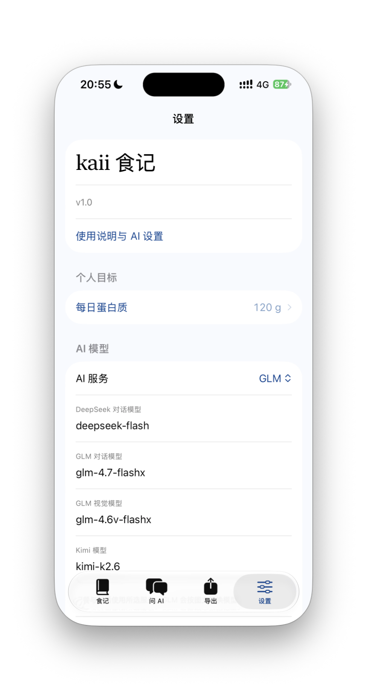](docs/screenshots/12-settings-models.png) |
| API Key | 本机数据与模型文档 |
| [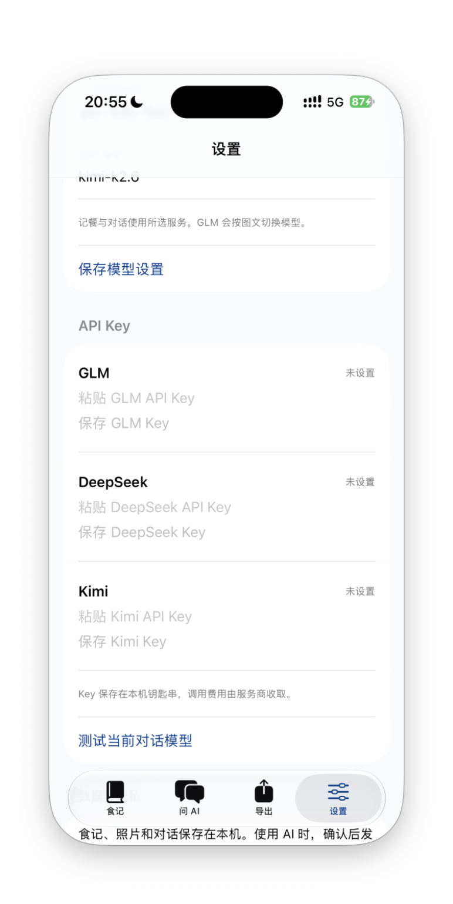](docs/screenshots/13-settings-keys.png) | [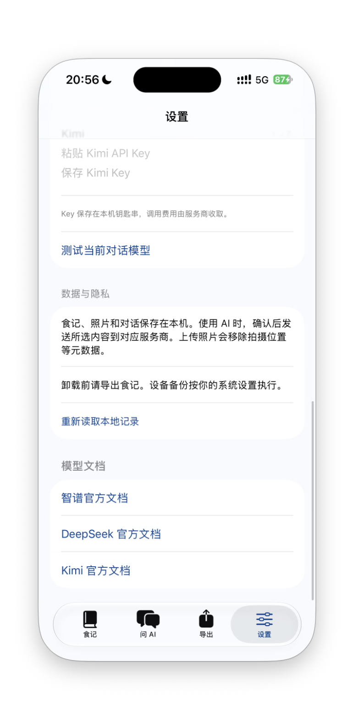](docs/screenshots/14-settings-privacy.png) |

## 怎么用

第一次打开时选一家 AI，填入自己的 API Key。也可以点「先逛逛」，手动记餐、添加常用食物和导出记录都能直接用。

界面支持简体中文、English 和繁體中文，可以跟随系统，也可以在首次打开页或设置里切换。AI 回复和导出标题随所选语言变化，已经保存的餐食、备注和聊天保留原文。

拍照记录适合当下这一餐，描述记录适合事后补记，比如“一碗米饭、一个卤鸡腿、半盘青菜”。包装食品可以扫描营养标签，再按实际食用量换算。AI 给出的份量和营养可以修改，确认后再保存。

「常用食物」用来保存固定搭配。蛋白粉可以写清品牌和一勺的克数，鸡蛋可以存成两个一份。每天选择日期和餐次，点加号即可加入食记。已记录的食物也能存为常用，iOS 长按食物，Android 点「存为常用食物」。

「问 AI」可以切换模型，按需附上最近七天的食记。想用自己习惯的 AI，就在「导出」选好日期，一键复制或保存为 Markdown，再发给它评价饮食搭配。每日蛋白质目标可在设置里自行填写。

## AI 账户

填一家即可。推荐先用 GLM，默认模型已配好，适合日常图文记餐。已有 DeepSeek 或 Kimi 账户的话，可以直接选对应服务。

| 服务 | 默认模型 | 获取 Key |
| --- | --- | --- |
| GLM | 文字 `glm-4.7-flashx`，照片 `glm-4.6v-flashx` | [智谱开放平台](https://open.bigmodel.cn/usercenter/proj-mgmt/apikeys) |
| DeepSeek | `deepseek-flash` | [DeepSeek 开放平台](https://platform.deepseek.com/api_keys) |
| Kimi | `kimi-k2.6` | [Kimi 开放平台](https://platform.moonshot.cn/console/api-keys) |

三家服务都可用于图文记餐和对话，模型名称可在设置里修改。API 按各平台规则计费，使用自己的账户余额。接口能力参考 [GLM 文档](https://docs.bigmodel.cn/)、[DeepSeek 图像输入](https://api-docs.deepseek.com/guides/vision/)和 [Kimi K2.6 文档](https://platform.kimi.com/docs/guide/kimi-k2-6-quickstart)。

### 用 AI 要花多少

以默认 GLM 模型算一笔小账。下面两次调用都不到一分钱，各调用 100 次，合计约 0.385 元。

| 用途 | 假设用量 | 单次费用 |
| --- | --- | --- |
| 文字问答，GLM 4.7 FlashX | 输入 2,000 tokens，输出 500 tokens | 约 0.0025 元，合 0.25 分 |
| 照片识别，GLM 4.6V FlashX | 图片与文字合计输入 4,000 tokens，输出 500 tokens | 约 0.00135 元，合 0.135 分 |

tokens 是模型处理内容的计量单位。输入包含问题、照片及附带的食记和对话，实际费用随用量变化，按服务商账单结算。这张表按 2026 年 10 月 22 日的[官方标准价](https://docs.bigmodel.cn/cn/guide/start/pricing)计算，输入均低于 32K，按无缓存命中计算。文字模型输入、输出每百万 tokens 分别为 0.5、3 元，视觉模型分别为 0.15、1.5 元。

## 数据放在哪里

食记、照片、常用食物和对话保存在本机。iOS 的 Key 放在系统钥匙串，Android 用系统 Keystore 加密保存。使用 AI 时，确认后才把所选照片、文字或食记发送给对应服务商。上传的照片会移除拍摄位置等元数据。

照片和回忆的营养值用于日常参考，份量、做法和用油会影响结果。有包装时优先核对标签，涉及疾病或持续身体不适时请找医生或营养师。

换设备或卸载前先导出。Android 另有 JSON 备份，可恢复食记与常用食物；iOS 当前提供食记导出，完整数据随设备备份保存。两端数据各自保存在设备上。

## 想自己改

iOS 使用 SwiftUI，营养模型、AI 请求和导出逻辑放在独立 Swift Package。Android 使用 Kotlin 和 Jetpack Compose，标签识别使用随包提供的中文 OCR 模型。

```text
App/                 iOS 界面与本机服务
Sources/KaiiFoodCore/ 营养模型、AI 请求、导出
Android/             Android App
Tests/               Swift 单元测试
TestsNative/         macOS 本机服务测试
```

[构建与测试](docs/BUILD.md)里写了本地运行和打包方式。欢迎提 Issue、提交修改，或者按自己的饮食习惯接着做。

MIT License · [Kai](https://github.com/ykkai-w)
